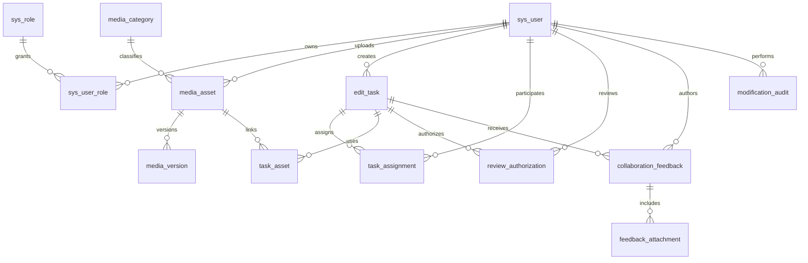

# 数据库设计

## Stage 1 落地

数据库 `mediaflow`，MySQL 8、InnoDB、utf8mb4。DDL 见 `sql/schema.sql`，本地开发种子见 `sql/data.sql`。

| 表 | 字段与约束 |
| --- | --- |
| sys_user | BIGINT 自增 id；username VARCHAR(50) 唯一、区分大小写；password_hash VARCHAR(100)；display_name VARCHAR(100)；status 0/1 CHECK 与索引；created_at / updated_at DATETIME |
| sys_role | BIGINT 自增 id；role_code VARCHAR(30) 唯一；role_name VARCHAR(50)；description VARCHAR(255) |
| sys_user_role | BIGINT 自增 id；user_id、role_id 外键；(user_id,role_id) 唯一；role_id 反查索引；用户删除级联关系，角色删除受限 |

用户与角色为多对多，允许任意 ADMIN / EDITOR / REVIEWER 组合。应用要求至少一个有效角色。响应排除密码字段。服务与数据库均校验状态。用户名采用二进制排序规则，`Admin` 和 `admin` 是不同账号；此规则后续如要改变需迁移而非只改前端。

当前时间由 Java / MySQL 使用本地 Asia/Shanghai 语义，DATETIME 无时区；跨时区部署应统一 UTC 并明确迁移。种子 SQL 可重复导入，不覆盖已有账号密码、状态或已有角色。数据库自动主键可能存在跳号，这是正常现象。

## 后续实体关系规划（任务、反馈与通用审计仍未建表）

- `media_category`：分类名称、父级（如需多级）、排序；初期素材单分类，通过可空外键支持未分类，统计明确是否包含未分类。
- `media_asset`：上传者、分类、标题、媒体类型、受控存储 key、大小、MIME、状态、创建更新时间、version 乐观锁；分页按 created_at/id 稳定排序。没有独立“文件库”业务。
- `media_version`：素材版本号、存储 key、提交者及时间，版本文件不可覆写；(asset_id,version_no) 唯一。
- `edit_task`：创建者、标题、状态、截止时间、version；`task_assignment` 记录任务、剪辑人员、分配人和有效状态，(task_id,user_id) 唯一。
- `task_asset`：任务与素材的关联及用途（输入 / 交付），避免覆盖原始素材。
- `review_authorization`：任务、审核人、授权人、有效期与撤销时间；(task_id,reviewer_id) 唯一。审核员访问必须同时满足有效授权。
- `collaboration_feedback`：任务、作者、接收者、文本正文、状态、可选媒体时间码；`feedback_attachment` 保存语音 / 视频附件 key、内容类型、时长等元数据，可复用 FileStorage；不引入文件库页面。
- `modification_audit`：actor_id、entity_type、entity_id、action、before_json、after_json、request_id、occurred_at；业务写入与审计同事务或采用可证明可靠机制，审计只追加，不记录密码、Token 或密钥。按实体及时间、操作人及时间建索引。

数据级授权必须覆盖列表、详情、预览 / 下载、更新、统计与反馈：ADMIN 全部；EDITOR 有效分配；REVIEWER 有效审核授权。统计应先应用权限条件，再按约定状态、分类和去重主键计算，避免关联表 JOIN 造成重复计数。

后续所有表通过明确迁移脚本演进，避免在启动时静默改表；删除策略与审计保留策略需按业务确认后落实。

## Stage 2 已落地媒体模型

迁移：sql/migrations/V002__media_management.sql。只增加四张表，不 DROP / TRUNCATE / ALTER 用户表，不覆盖种子账号或既有媒体数据；命名迁移脚本需显式执行，应用启动不自动 DDL。

| 表 | 主要列与约束 |
| --- | --- |
| media_file | id、original_filename、storage_key（唯一）、mime_type、file_size（>0）、uploaded_by（用户外键）、created_at |
| media_category | id、category_name（全局唯一）、parent_id（自引用 RESTRICT）、sort_order、status（0/1）、created_at、updated_at |
| media_asset | id、title、description、file_id（唯一外键）、category_id（可空 RESTRICT）、media_type（IMAGE/AUDIO/VIDEO）、created_by、updated_by、created_at、updated_at、status（ACTIVE/ARCHIVED）、version、upload_key；(created_by,upload_key) 唯一 |
| media_change_log | id、asset_id、operator_id、operator_name、asset_title、operation_type、field_name、old_value、new_value、old_label、new_label、created_at；素材与操作人 RESTRICT 外键 |

素材按 status/created_at/id、category_id/status、media_type/status、created_by/created_at 索引；日志按 asset_id/created_at/id 和 operator_id/created_at/id 索引；分类 parent_id 索引。业务仅归档素材，文件元数据与文件保留，分类删除必须检查所有引用（包括归档）。

两级分类与防循环由 Service 锁定并校验，外键防止悬空父节点；应用不开放随意写 SQL。分类 ID 的审计旧 / 新值不是外键，配合名称快照在分类合法删除后仍能追溯。

当前 media_asset 使用可空 category_id；MyBatis 更新该字段与分类 parent_id 时显式允许写 NULL，避免“取消分类”被框架默认的忽略空值策略吞掉。version 由锁定更新显式增加。

上述旧规划中的 media_version、task_*、collaboration_feedback、modification_audit 仍是后续范围。当前使用 media_change_log 落地媒体字段审计，不新增通用审计表或任务权限表。

## Stage 3 已落地任务模型

迁移 V003__editing_tasks.sql 新增 editing_task、editing_task_asset、editing_task_log，不重建 Stage 1/2 表。media_asset 仅增加 access_scope VARCHAR(12) NOT NULL DEFAULT LIBRARY；通过 information_schema 判断列是否已存在，安全重复执行迁移。旧行保留且默认共享。

editing_task：BIGINT id；title(200)、description(4000)；created_by / assignee_id / reviewer_id 用户 RESTRICT 外键；priority LOW/NORMAL/HIGH/URGENT；due_at 可空；status 四态 CHECK；created_at / updated_at、version。索引覆盖 assignee/status/created/id、reviewer/status/created/id、status/priority/created/id 与 due_at/id。

editing_task_asset：id、task_id / asset_id RESTRICT 外键，(task_id,asset_id) 唯一，反向 (asset_id,task_id) 索引。当前关联可由 ADMIN 在非已完成任务中调整，旧关联 ID 记录在 ASSETS_CHANGED 日志中；不复制或删除 media_file。

editing_task_log：id、task_id / operator_id RESTRICT 外键、operator_name 快照、operation_type、field_name、old_value / new_value TEXT、reason(2000)、created_at；按 task/time/id 和 operator/time 索引。任务创建、字段调整、状态动作均写入，不提供日志修改 / 删除 API。

原先规划的 edit_task / task_assignment / review_authorization 在本阶段合并为 editing_task 的单执行人 / 单审核人字段，匹配当前明确需求；历史分配变更由日志保留。Stage 4 如有多人审核等新需求再以独立迁移演进，不提前创建协同反馈表。
